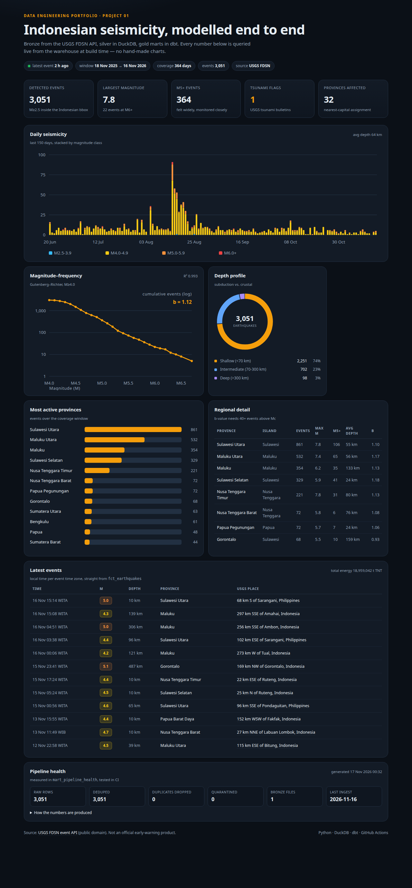
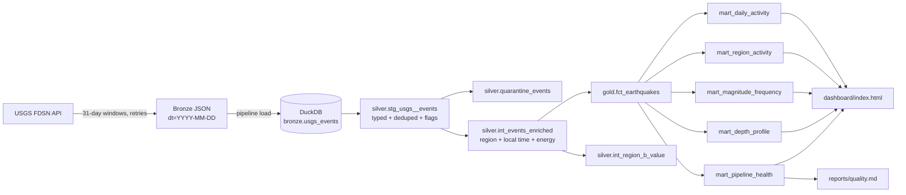

# Indonesian Seismicity Lakehouse

[](https://github.com/aaageee/id-seismic-lakehouse/actions/workflows/ci.yml)
[](https://www.python.org/)
[](https://docs.getdbt.com/)
[](https://duckdb.org/)
[](LICENSE)

An end-to-end ELT pipeline for Indonesian earthquake data: raw USGS GeoJSON in a
partitioned lake, typed and tested SQL models in DuckDB via dbt, and a static
dashboard that is rebuilt from the warehouse on every run.



*Screenshot from a local build: 3,051 events over 364 days, national b-value 1.12 (R² 0.993).*

---

## The problem

Earthquake data is a good stress test for a data pipeline because the source is
hostile in realistic ways:

- **events get revised** for days after they happen (magnitude, depth, location);
- a daily incremental pull **overlaps** the previous one, so naive ingestion
  duplicates rows;
- timestamps arrive as **epoch milliseconds in UTC**, while every consumer thinks
  in WIB / WITA / WIT;
- coordinates are **`[longitude, latitude, depth]`** — swapping them silently
  produces a plausible-looking but completely wrong dataset (I did this once;
  the quarantine model caught it, which is exactly why it exists);
- statistical outputs like the Gutenberg–Richter **b-value** are easy to compute
  and easy to mislead with if you ignore catalog completeness.

This repository is my answer to those problems with a stack that anyone can run
locally: Python, DuckDB, dbt, and plain SQL.

## What it does

| Stage | Command | Output |
|---|---|---|
| Ingest | `python -m pipeline ingest --days 365` | Monthly-window USGS queries → `data/lake/usgs/dt=YYYY-MM-DD/events.json` |
| Load | `python -m pipeline load` | `bronze.usgs_events` in DuckDB (raw payload + lineage columns) |
| Model | `python -m pipeline transform` | dbt: `silver` views, `gold` marts, 41 tests |
| Gate | `python -m pipeline quality` | `reports/quality.md` with pass/warn/fail per check |
| Serve | `python -m pipeline dashboard` | `dashboard/index.html` + `dashboard/data.json` |

`python -m pipeline all --days 365` runs the whole thing. `python -m pipeline demo`
does the same against a committed 186-event sample, with **no network calls** —
that is what CI runs.

### Architecture



## Results from the current build

| Metric | Value |
|---|---|
| Events (M≥2.5, Indonesian bbox) | **3,051** |
| Coverage window | 18 Nov 2025 → 16 Nov 2026 (364 days) |
| Largest magnitude | **7.8** |
| M5+ / M6+ events | 364 / 22 |
| Tsunami-flagged events | 1 |
| Provinces with activity | 32 |
| Quarantined rows | 0 |
| National b-value (Mc = 4.0) | **1.12** (R² 0.993, n = 3,045) |
| Most active province | Sulawesi Utara (861 events, max M7.8) |

The dashboard is generated from `gold` at build time; nothing in the screenshot
is hand-written.

## Quickstart

Requires Python 3.10+ (3.12 recommended). No Docker, no cloud account.

```bash
git clone https://github.com/aaageee/id-seismic-lakehouse.git
cd id-seismic-lakehouse
make install            # creates .venv and installs the project
source .venv/bin/activate

make demo               # offline: builds the warehouse from data/sample
open build/demo/dashboard/index.html
```

Live data instead of the sample:

```bash
make ingest DAYS=365    # ~13 API calls, ~30 seconds
make build              # load → dbt → quality report → dashboard
open dashboard/index.html
```

Useful targets: `make test`, `make lint`, `make quality`, `make freshness`,
`make clean`. Every path can be overridden with environment variables
(`SEISMIC_DATA_DIR`, `SEISMIC_DB`, `SEISMIC_DASHBOARD_DIR`) — that is how the
tests build an isolated warehouse in a temp directory.

<details>
<summary>Troubleshooting setup</summary>

- **Debian/Ubuntu minimal images:** `python3 -m venv` fails with
  `ensurepip is not available`. Install the venv package first:
  `sudo apt-get install -y python3-venv`.
- **`dbt: command not found`:** the venv is not active, or dependencies were
  installed globally. Run `source .venv/bin/activate` (or set
  `SEISMIC_DBT_BIN=/path/to/dbt`).
- **Empty dashboard:** check `reports/quality.md` for a `FAIL` row and re-run
  `make demo` to confirm the pipeline itself is healthy.
</details>


## Data model

Three schemas, one direction of flow:

- **bronze** — raw GeoJSON, one row per file, with `_source_file`,
  `_ingest_date` and `_loaded_at`. Never mutated by dbt.
- **silver** — typed events, quarantine, enrichment (nearest province, local
  time zone, energy), and the per-province b-value fit.
- **gold** — `fct_earthquakes` plus four marts and one health row.

The fact table is at event grain (`event_id` is the primary key and is tested
`unique` + `not_null`). `mart_daily_activity` uses a dense date spine so quiet
days are zeros, not gaps. The full column list is in
[`docs/data_dictionary.md`](docs/data_dictionary.md).

### Definitions that matter

| Metric | Definition |
|---|---|
| Province | Nearest provincial capital by haversine distance, capped at 700 km; otherwise `Luar wilayah`. |
| Local time | Time zone derived from longitude: `Asia/Jakarta` (<120°E), `Asia/Makassar` (120–135°E), `Asia/Jayapura` (>135°E). |
| Energy | `log10(E_joules) = 4.8 + 1.5 * magnitude`, reported in tons of TNT. |
| b-value | Least-squares slope of `log10(N≥M)` on M for M≥4.0, using bins with ≥5 cumulative events. Published per province only with ≥40 events above Mc and a fit inside 0.3–2.5. |
| Freshness | Hours between the newest event origin time and build time. Historical sample builds warn by design. |

## Data quality and tests

**dbt tests (41):** schema tests (`unique`, `not_null`, `accepted_values`) plus
singular tests for invariants:

- no duplicate event ids in `fct_earthquakes`;
- daily mart reconciles exactly with the fact table;
- no future origin timestamps;
- every event has a region and a non-negative distance;
- fitted b-values stay inside the plausible 0.3–2.5 band.

**Python checks:** the health mart is turned into
[`docs/quality_report_example.md`](docs/quality_report_example.md) — 10 checks
covering reconciliation, quarantine rate, coordinate bounds, freshness, and the
presence of the national fit. Failures exit non-zero; staleness is a `WARN` so
the offline demo stays green.

**pytest (17 tests):** window splitting and haversine maths, revision merging
and idempotent partition writes, a fake HTTP session for ingestion, and an
integration test that builds the entire dbt project against the committed sample
then asserts on the marts and the rendered HTML.

## Orchestration and CI/CD

- `.github/workflows/ci.yml` — on every push/PR: offline demo build, 41 dbt
  tests, 17 pytest tests, ruff, and an uploaded dashboard artifact.
- `.github/workflows/refresh.yml` — nightly at 03:17 WIB: ingest 365 days,
  rebuild the warehouse, deploy the dashboard to GitHub Pages.

To get the live URL, enable **Settings → Pages → Source: GitHub Actions** after
pushing. The deploy workflow uses `actions/deploy-pages`, so no build output is
committed except the snapshot in `dashboard/`.

## Repository layout

```
pipeline/            Python CLI: ingest, load, transform, quality, dashboard
  ingest.py          USGS client, windowing, retries, revision merge, run log
  warehouse.py       DuckDB load + query helpers
  transform.py       dbt runner (adapter-agnostic interface)
  quality.py         health-mart checks → markdown gate
  dashboard.py       HTML renderer (self-contained, inline SVG)
  charts.py          dependency-free SVG charts
models/
  staging/           typed + deduplicated source
  intermediate/      enrichment, quarantine, b-value fit
  marts/             fact table, four marts, health mart
seeds/               38 Indonesian provinces (capitals, island groups)
tests/               singular dbt tests + pytest suite
scripts/             sample generator (reproducible fixture)
docs/                screenshot, data dictionary, ADRs, quality example
```

## Engineering decisions

The interesting trade-offs are written down as ADRs in
[`docs/decisions.md`](docs/decisions.md): why DuckDB instead of a cloud
warehouse, ingestion-time partitions vs. upserts, nearest-capital geocoding,
the b-value reliability threshold, static HTML over a BI tool, and why the
quality gate is code.

Two decisions I would defend in an interview:

1. **Deduplicate in SQL, not in the crawler.** Bronze keeps every revision, so a
   logic bug in the warehouse is fixable without re-downloading history.
2. **Return null instead of a shaky b-value.** A province with 12 events above
   Mc gets a blank cell and `is_b_value_reliable = false`, not a confident
   number that a reader might quote.

## Limitations

- Region assignment is a centroid heuristic, not administrative boundaries.
- The catalog is USGS-only; local BMKG solutions arrive sooner and may differ in
  magnitude for the same event.
- USGS completeness varies offshore, so small events far from the coast are
  under-represented. This is why the b-value uses M≥4.0.
- One warehouse file, one writer. Fine for a nightly batch; not a serving layer
  for concurrent analysts.
- The dashboard is a static snapshot — no filters, no drill-down.

## If this had to run at 100× the volume

- Bronze → S3/MinIO with Iceberg or Delta, monthly compaction, lifecycle rules.
- Airflow or Dagster for schedules, retries, backfills and lineage instead of a
  Makefile; the CLI commands were designed to become task boundaries.
- Spark or Trino for reprocessing; dbt stays as the transformation contract.
- Contracts + Great Expectations/Soda on the source, not just tests on the output.
- Metrics and freshness exported to Prometheus/Grafana; the health mart is
  already the right shape.

## Data source and license

Earthquake data: [USGS FDSN event API](https://earthquake.usgs.gov/fdsnws/event/1/),
public domain. Province coordinates are approximate capital locations in
`seeds/id_provinces.csv`.

Code: MIT. This is an analytics project, **not** an official early-warning or
tsunami product. For emergencies, use BMKG and official channels.
